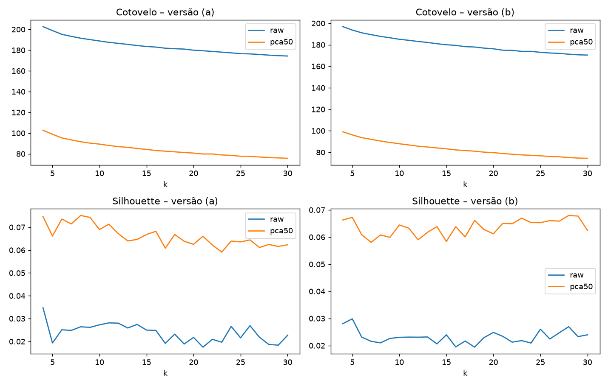
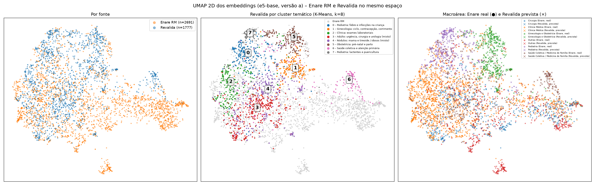
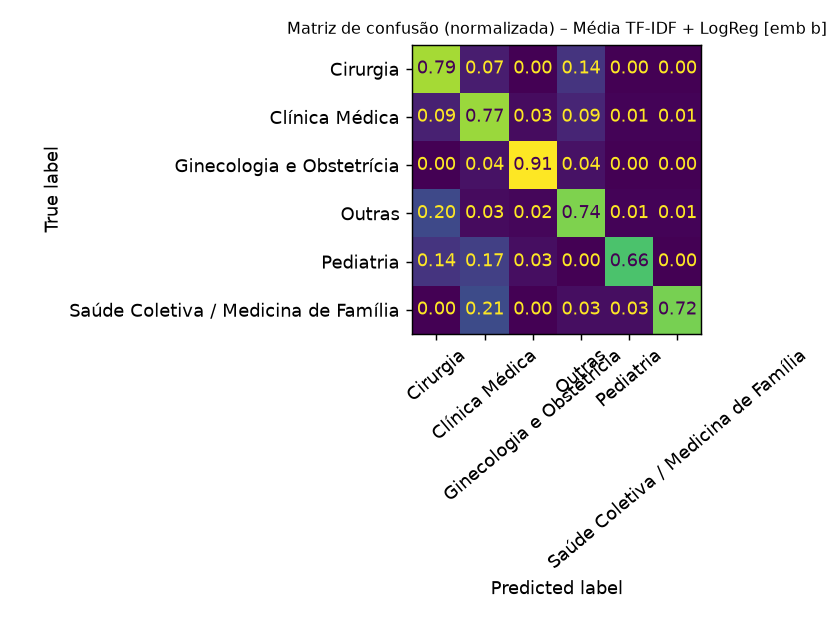
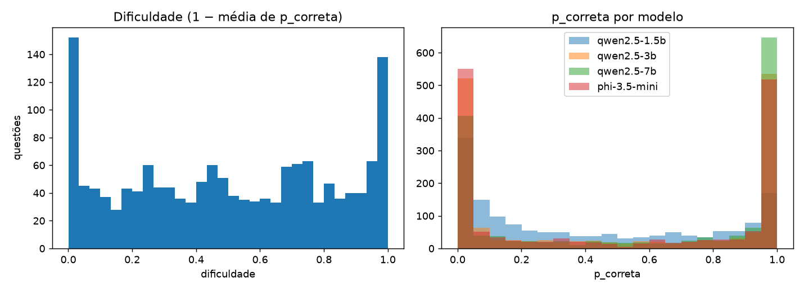
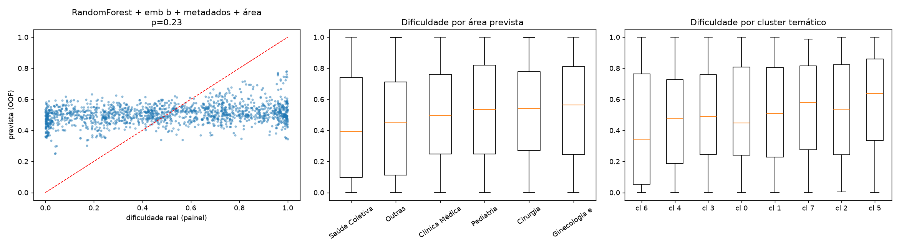

# Busca semântica de questões médicas com Agrupamento, Classificação e Regressão

Trabalho da disciplina de **Agentes Inteligentes**. O produto é um sistema em que o usuário digita uma dúvida ou um caso clínico e recebe questões parecidas de provas passadas do **Revalida**, cada uma com a **área** (real ou prevista), o **cluster temático** e a **dificuldade estimada**.

O enunciado do trabalho exige que a solução combine os três grandes tipos de tarefa de Aprendizado de Máquina. Este documento mostra onde cada um aparece, por que as decisões foram tomadas e quais são os resultados, **inclusive os fracos**.

---

## 1. Como o projeto atende aos três critérios

| Critério | Tarefa no projeto | Onde está | Resultado principal |
|---|---|---|---|
| **Agrupamento** (não supervisionado) | K-Means (k = 8) sobre embeddings das questões do Revalida, comparado com HDBSCAN; descobre temas sem usar nenhum rótulo | `src/clustering.py`, `src/clustering_final.py` | Silhouette 0,075 (estrutura fraca); NMI 0,44 contra as 37 especialidades reais do Enare |
| **Classificação** (supervisionado) | Prever a **macroárea** (Clínica, Cirurgia, Pediatria, GO, Saúde Coletiva, Outras) a partir do texto | `src/classificacao.py` | F1 macro 0,794 (validação cruzada) e 0,758 (teste final) no Enare |
| **Previsão / Regressão** | Prever a **dificuldade** (contínua, 0 a 1) de uma questão a partir do texto | `src/painel_dificuldade.py`, `src/gerar_alvo.py`, `src/regressao.py` | R² 0,049 e Spearman 0,21 no teste final: sinal fraco, porém acima do baseline |

As três tarefas **alimentam o mesmo produto**, e não são exercícios isolados:

```
 pergunta do usuário ──► embedding ──► KNN no banco vetorial (FAISS) ──► top-k questões
                              │                                              │
                              └─► CLASSIFICAÇÃO: área da pergunta            ├─ área (classificação)
                                                                             ├─ cluster temático (agrupamento)
                                                                             └─ dificuldade (regressão)
```

Duas ressalvas, para não superestimar o trabalho:

- **"Semi-supervisionado".** O classificador é **supervisionado**: treina onde há rótulo (Enare) e é aplicado onde não há (Revalida). Isso é *transferência de rótulos entre domínios*. A etapa formal de semi-supervisionado, o *self-training* (reaproveitar previsões confiantes para retreinar), estava prevista como opcional e **não foi executada** (seção 9).
- **Os três resultados têm qualidade diferente.** A classificação é boa dentro do Enare, e o agrupamento e a regressão são fracos. Os números fracos não foram escondidos, e a seção 7 explica por que eles são esperados.

---

## 2. Dados

**Fonte:** `Larxel/healthqa-br` (Hugging Face), 5.632 questões de provas de saúde em português, em um único *split* `train`.

| Fonte da prova | Linhas | Tem `group` (especialidade)? |
|---|---|---|
| Revalida | 1.777 | **Não**: 100% nulo |
| Enare Residência Médica | 2.691 | Sim: 37 especialidades |
| Enare Multiprofissional | 1.164 | Sim (fora do escopo) |

### Decisão de escopo e por que ela é central

A decisão foi **trabalhar só com o Revalida** como produto, que é a prova de revalidação do diploma médico, de natureza clínica e generalista. O problema: **o Revalida não tem nenhuma linha com especialidade**. Sem rótulo, não se treina um classificador nem se mede o agrupamento contra algo real.

A solução foi usar o **Enare Residência Médica como base rotulada**:

- o classificador treina no Enare (2.691 questões com especialidade, agrupadas em 6 macroáreas);
- ele é aplicado ao Revalida, que passa a ter `area_final`, `area_origem = "prevista"` e `area_confianca`;
- o Enare Multiprofissional ficou **de fora** porque inclui profissões não médicas (enfermagem, nutrição etc.), cujos rótulos não se aplicam ao Revalida.

O custo disso é o *domain shift* (seção 7.3): as duas provas têm estilos diferentes.

### Dataset processado e validação

Um colega do grupo separou o enunciado das alternativas (`data/healthqa_processed.parquet`). As colunas reais são `questão` (enunciado) e `A…E` (alternativas), e o script as renomeia para `enunciado` e `alt_A…alt_E`.

`src/validacao.py` **validou** o trabalho do colega, sem refazê-lo. Foram verificados enunciado vazio ou curto, alternativas vazias, marcadores residuais (`A)`, `(A)`, `'A':`), alternativas coladas, `answer` apontando para alternativa nula e alternativas repetidas.

- **Resultado:** o regex marcou 16 ids, mas **todos eram falsos positivos** (`D-penicilamina` casando com `D-`; `(DTP+Hib+Hep B)` casando com `B)`; enunciados legitimamente curtos como "A criptotia corresponde a:"). Não houve problema real de separação.
- **Escopo final do pipeline:** 4.468 linhas (Revalida + Enare RM), em `data/escopo.parquet`.
- **Estrutura:** 83% das questões do Revalida têm 4 alternativas, contra 99,9% com 5 no Enare. Os enunciados do Revalida são mais longos (média de 700 caracteres, contra 405 no Enare), e **o Enare RM é só de 2024**.

### Duplicatas: um risco metodológico que moldou o projeto

Há 256 enunciados repetidos no Revalida (203 com alternativas idênticas, todos no mesmo ano, provavelmente cadernos diferentes da mesma prova). No Enare há 497. Se uma cópia cair no treino e outra no teste, a métrica fica inflada (vazamento). Por isso:

- criamos `chave_dup` (enunciado normalizado);
- **todos os splits são agrupados por `chave_dup`** (`StratifiedGroupKFold`), então as cópias ficam sempre do mesmo lado;
- os modelos treinam só nas **1.521 questões únicas** do Revalida;
- a busca remove duplicatas do resultado.

Também verificamos que **não há** enunciado igual entre Enare e Revalida (0 em comum), portanto não há vazamento entre as duas provas.

---

## 3. Como instalar e executar

Requisitos: Linux, Python 3.13 e GPU NVIDIA (recomendada; só o painel de LLMs a exige). O projeto foi desenvolvido em i5-12600K, 31 GB de RAM e RTX 3060 de 12 GB.

> **Por que Python 3.13?** O Python do sistema era o 3.15, uma versão muito recente. Por precaução com a compatibilidade de torch, faiss e hdbscan, usamos o 3.13 (que o `pyproject.toml` já exigia). Não testamos o 3.15.

```bash
uv venv --python 3.13 .venv
uv pip install --python .venv/bin/python -r requirements.txt   # baixa o torch com CUDA (~3 GB)

# Ordem de execução (cada etapa lê os arquivos da anterior)
.venv/bin/python src/validacao.py                  # Etapa 1: valida e cria data/escopo.parquet
.venv/bin/python src/embeddings.py                 # Etapa 2: embeddings em embeddings/*.npy
.venv/bin/python src/clustering.py                 # Etapa 3: escolha de k, HDBSCAN, ARI/NMI
.venv/bin/python src/clustering_final.py           # Etapa 3: K-Means final, nomes, UMAP
.venv/bin/python src/classificacao.py              # Etapa 4: classificador de área
.venv/bin/python src/exportar_classificador.py     #          (exporta o modelo para o sistema)
.venv/bin/python src/painel_dificuldade.py --teste --modelos qwen2.5-1.5b   # Etapa 5: teste de 50 questões
.venv/bin/python src/painel_dificuldade.py --lote 2                         #          painel completo (~30 min)
.venv/bin/python src/painel_dificuldade.py --lote 2 --modelos phi-3.5-mini  #          4º modelo
.venv/bin/python src/gerar_alvo.py                 #          alvo de dificuldade + testes de sanidade
.venv/bin/python src/regressao.py                  #          regressão da dificuldade
.venv/bin/python src/regressao_knn.py              #          variante kNN (comparação)
.venv/bin/python src/visualizacao.py               # gráfico de dispersão Enare + Revalida
.venv/bin/streamlit run app.py                     # Etapa 6: interface do sistema
```

O painel de LLMs salva o progresso a cada lote e **retoma de onde parou** se for interrompido. Todas as sementes aleatórias estão fixas (`SEED = 42`), e os artefatos intermediários ficam em disco (`embeddings/`, `resultados/`, `data/`).

Para buscar pela linha de comando: `.venv/bin/python src/sistema.py "paciente com dor torácica"`.

---

## 4. Etapa 2: embeddings e banco vetorial

**O que é:** um *embedding* transforma um texto em um vetor de números, de modo que textos com significado parecido ficam próximos. Isso permite buscar por **significado** e não por palavras iguais.

**Escolha do modelo:** `intfloat/multilingual-e5-base` (768 dimensões).

| Critério | `paraphrase-multilingual-mpnet-base-v2` | **`multilingual-e5-base`** (escolhido) |
|---|---|---|
| Contexto máximo | 128 tokens | **512 tokens** |
| Treino | Paráfrase (similaridade simétrica) | Busca pergunta→passagem |
| Efeito aqui | Cortaria boa parte dos enunciados | Cobre quase todos |

Os enunciados do Revalida têm em média 183 tokens (p95 = 367) e, com as alternativas, 284 (p95 = 484). Com 128 tokens, o mpnet truncaria boa parte deles (**não testamos o mpnet**: a escolha se baseia nesse limite de contexto, e não numa comparação de desempenho). Com 512, só **18 de 1.777 textos (a) e 69 (b)** são truncados.

O e5 exige prefixos: `query: ` para a pergunta do usuário e `passage: ` para as questões indexadas.

**Duas versões de texto**, para comparar:

- **(a)** só o enunciado;
- **(b)** enunciado + alternativas `(A)…(E)`.

**Banco vetorial:** FAISS `IndexFlatIP` (busca **exata**, produto interno sobre vetores normalizados, o que equivale ao cosseno). Com 1.777 vetores a busca exata é instantânea, então um índice aproximado (IVF, HNSW) ou um servidor (ChromaDB) só acrescentaria complexidade, sem ganho.

**Teste qualitativo:** "paciente com dor torácica e suspeita de infarto" devolve questões de emergência e cardiologia, e "vacinação em crianças menores de 1 ano" devolve questões de puericultura. As similaridades ficam comprimidas (0,87 a 0,89), o que é típico do e5. Vale a ordem, e não o valor absoluto.

---

## 5. Etapa 3: agrupamento (não supervisionado)

**Ideia:** descobrir temas **sem usar rótulo algum**, agrupando questões cujos embeddings são próximos.

**Método:** K-Means. As escolhas e o motivo de cada uma:

- **PCA para 50 dimensões antes do K-Means.** Em 768 dimensões as distâncias perdem contraste (a "maldição da dimensionalidade"). O PCA 50 **dobrou** a silhouette em relação aos vetores brutos.
- **Ajuste nas questões únicas**, para as duplicatas não pesarem em dobro.
- **k escolhido pelo cotovelo e pela silhouette**, de k = 4 a 30, nas versões (a) e (b), com e sem PCA.



**Resultado honesto:** **não há cotovelo nítido** e a silhouette fica em torno de 0,03 a 0,075, sem pico claro. Os dados formam um **contínuo temático**, pois são todos casos clínicos com a mesma estrutura de texto. O k é, em boa parte, uma escolha de interpretabilidade. A melhor silhouette (0,075) foi em **k = 8, versão (a), PCA 50**, e é o que usamos.

**HDBSCAN** (clustering por densidade, que não exige k) foi comparado, aplicado sobre UMAP de 10 dimensões:

| min_cluster_size | Clusters (versão a) | Ruído |
|---|---|---|
| 10 | 33 | 38,4% |
| 20 | 2 | 0% |
| 40 | 3 | 11,0% |

Ele **não produziu uma partição estável**: ou deixa mais de um terço das questões sem grupo, ou colapsa em 2 a 3 blocos. Por isso o K-Means ficou como método principal e o HDBSCAN como comparação.

### Avaliação externa (ARI e NMI)

O Revalida não tem rótulo, então **a avaliação externa só pode ser feita no Enare** (K-Means contra os rótulos reais):

| Embedding | Alvo | k | ARI | NMI |
|---|---|---|---|---|
| (a) | macroárea | 6 | 0,055 | 0,083 |
| (a) | especialidade (`group`) | 37 | 0,153 | 0,377 |
| (b) | macroárea | 6 | 0,108 | 0,139 |
| (b) | especialidade (`group`) | 37 | 0,210 | **0,442** |

**Como ler:** o ARI e o NMI contra as 6 macroáreas são baixos. Os clusters seguem o **tema** (a especialidade, NMI 0,44) e não a divisão grossa em 6 áreas, que é heterogênea (a macroárea "Outras" junta Homeopatia e Radiologia). Isso também justifica usar **classificação supervisionada** para a área, em vez de aproveitar os clusters como rótulo. A versão (b) é melhor que a (a) nos dois alvos.

### Os 8 clusters (nomes manuais, validados com as questões mais próximas do centroide)

| Cluster | n | Nome |
|---|---|---|
| 0 | 245 | Pediatria: febre e infecções na criança |
| 1 | 193 | Ginecologia: ciclo, contracepção, corrimento |
| 2 | 223 | Clínica: exames laboratoriais |
| 3 | 393 | Adulto: urgência, cirurgia e urologia (misto) |
| 4 | 270 | Nódulos: mama e tireoide / idosos (misto) |
| 5 | 203 | Obstetrícia: pré-natal e parto |
| 6 | 158 | Saúde coletiva e atenção primária |
| 7 | 92 | Pediatria: lactentes e puericultura |

Os nomes automáticos por TF-IDF saíram ruins em alguns casos (apareciam "esposa" e "moto"), e por isso os nomes foram dados manualmente, olhando as questões centrais de cada grupo. Como checagem, aplicamos o K-Means do Revalida ao Enare: 51% das questões de Pediatria caem no cluster 0 e 18% no 7, e 40% e 37% das de Ginecologia e Obstetrícia caem nos clusters 1 e 5. Os clusters 3 e 4 são "guarda-chuva" (misturam clínica, cirurgia e saúde coletiva) e são a principal fraqueza do k = 8.



*Esquerda: por fonte (há uma região só do Enare, as especialidades que o Revalida não cobre). Centro: clusters do Revalida. Direita: macroárea real (Enare, círculos) e prevista (Revalida, cruzes).*

---

## 6. Etapa 4: classificação da macroárea

**Objetivo:** dar uma área a cada questão do Revalida, que não tem esse dado.

**Mapeamento de especialidade para macroárea** (6 classes, definido antes de qualquer modelo e aprovado antes de ser aplicado): Clínica Médica (1.172 questões do Enare), Cirurgia (545), Pediatria (143), Ginecologia e Obstetrícia (111), Saúde Coletiva/Medicina de Família (146) e Outras (574). O mapeamento completo está em `src/areas.py`.

**Protocolo de avaliação** (definido **antes** de comparar modelos, para não "ajustar até dar certo"):

1. 20% do Enare (539 questões), separados por grupo de duplicatas e estratificados por classe, viram **teste final**, que não é tocado até o fim.
2. Os 80% restantes entram em validação cruzada estratificada agrupada (5 folds) para escolher o modelo.
3. `class_weight="balanced"` em todos os modelos e **F1 macro** como métrica principal, porque as classes são desbalanceadas (Clínica 1.172 contra GO 111) e a acurácia sozinha enganaria.

**Regra respeitada:** os rótulos do K-Means **nunca** foram usados para avaliar o classificador, porque seria circular.

### Resultados

| Modelo | Acurácia (CV) | F1 macro (CV) |
|---|---|---|
| **Média TF-IDF + LogReg [emb b]** | **0,804** | **0,794** |
| TF-IDF + Regressão Logística (baseline) | 0,763 | 0,740 |
| Regressão Logística [emb b] | 0,731 | 0,709 |
| SVM linear [emb b] | 0,737 | 0,682 |
| Regressão Logística [emb a] | 0,690 | 0,674 |
| SVM linear [emb a] | 0,685 | 0,634 |
| Random Forest [emb b] | 0,585 | 0,384 |
| Random Forest [emb a] | 0,553 | 0,352 |

**Teste final** (usado uma única vez): baseline TF-IDF, acurácia 0,751 e F1 macro 0,750; **modelo escolhido, acurácia 0,766 e F1 macro 0,758**.

**O que aprendemos:**

- **O baseline simples (TF-IDF) venceu todos os modelos que usavam só embedding.** Palavras-chave como "gestação", "criança" e "cirurgia" carregam muito sinal de especialidade. Foi um resultado inesperado, e por isso mantivemos o baseline como comparação.
- **Combinar os dois** (média das probabilidades do TF-IDF e do embedding b) deu o melhor resultado no CV (+0,054 de F1), porque os dois erram de formas diferentes. Esse modelo não estava no plano original, e foi adicionado pelo desempenho.
- **No teste final o ganho é pequeno** (0,750 para 0,758). As classes pequenas têm 23 a 29 exemplos no teste, então a diferença está dentro do ruído. Só afirmamos o que a validação cruzada sustenta.
- **A versão (b) (com alternativas) é melhor que a (a)**, como no agrupamento.
- O **Random Forest** foi o pior, o que é comum em embeddings densos de alta dimensão.



### Aplicação ao Revalida

O modelo final foi treinado em **todo** o Enare e aplicado às 1.777 questões do Revalida (`resultados/area_revalida.parquet`, com `area_final`, `area_origem = "prevista"` e `area_confianca`):

| Área prevista | n |
|---|---|
| Clínica Médica | 614 |
| Ginecologia e Obstetrícia | 343 |
| Saúde Coletiva / Medicina de Família | 303 |
| Pediatria | 301 |
| Cirurgia | 172 |
| Outras | 44 |

- A **confiança é baixa**: média de 0,56, com 44,5% das previsões abaixo de 0,5 e só 10,9% a partir de 0,8. São 6 classes, e a média de duas distribuições achata as probabilidades.
- **Coerência com os clusters:** o cluster de lactentes vira 99% Pediatria, o de exames laboratoriais 87% Clínica e o de pré-natal e parto 80% GO. Isso é uma evidência indireta de que a previsão faz sentido, mas **não substitui validação com rótulo real**.
- A macroárea "Outras" quase some no Revalida (44 questões). Isso é coerente, pois ela agrupa especialidades fora do escopo do Revalida.

---

## 7. Etapa 5: previsão (regressão) da dificuldade

### 7.1 O problema: o dataset não tem dificuldade

Nenhuma coluna indica quão difícil é uma questão. Para fazer **regressão** precisamos de um alvo numérico, então **o construímos**.

**Ideia:** usar um **painel de modelos de linguagem (LLMs) locais**. Uma questão é "difícil" se os modelos dão pouca probabilidade à alternativa correta. Para cada questão e modelo, **lemos os logits** do próximo token (por isso usamos `transformers` direto e não Ollama, que não expõe os logits) e calculamos a probabilidade de cada letra por softmax só entre as alternativas existentes.

| Modelo | Precisão | Acurácia no Revalida | Acaso |
|---|---|---|---|
| Qwen2.5-1.5B-Instruct | fp16 | 44,0% | 24% |
| Qwen2.5-3B-Instruct | fp16 | 50,8% | 24% |
| Qwen2.5-7B-Instruct | 4-bit | 60,4% | 24% |
| Phi-3.5-mini-instruct | 4-bit | 49,2% | 24% |

**Por que esses modelos:** cabem na GPU (12 GB, com ~8 GB livres), não têm acesso restrito e variam em tamanho (gradiente de capacidade) e família (Qwen e Phi). O 0,5B foi descartado antes de rodar, porque tende ao acaso em questão médica. Todos os quatro passaram do acaso e a acurácia **cresce com o tamanho**, o que é o esperado de um painel bem calibrado.

**Alvo:** `dificuldade = 1 − média(p_correta)` entre os modelos. Também guardamos `taxa_erro` (proporção de modelos que erraram), com correlação de 0,97 entre os dois.

**Dois problemas reais encontrados e corrigidos**, que mostram por que o teste pequeno antes do experimento completo vale a pena:

1. **Prompt mal terminado.** Com o prompt terminando em `Resposta:`, o modelo preferia o token ` (` e só **38%** da probabilidade caía nas letras. Terminando em `Resposta: (`, subiu para **100%**.
2. **Tokenização do Phi.** O tokenizador do Phi (SentencePiece) tem duas formas da mesma letra (`▁A` e `A`). A primeira versão media a probabilidade do token errado e dava **0,00** de massa nas letras, com uma "acurácia" de 56% que era ruído. A correção considera as duas formas.

**Teste de sanidade do alvo:** acurácias acima do acaso, sem viés relevante de letra, nenhuma questão truncada, e correlação moderada entre modelos (Spearman 0,46 a 0,60). Moderada é o desejável: modelos idênticos não somariam informação, e modelos sem relação indicariam ruído.



**Característica importante:** o alvo é **bimodal** (picos em 0 e em 1), pois os LLMs são muito confiantes: acertam ou erram com probabilidade próxima de 1. Isso limita o que a regressão consegue.

> **Limitação conceitual (deve ser dita na apresentação):** isto é a dificuldade **para um LLM**, e não para um estudante. Uma questão pode ser fácil para um aluno e difícil para o modelo (e vice-versa). É uma **proxy**, e não a dificuldade real.

### 7.2 O modelo de regressão

**Entradas:** embedding do enunciado e das alternativas (b), tamanho do enunciado e das alternativas, número de alternativas, número de valores numéricos e unidades laboratoriais, presença de tabela, pergunta negativa ("exceto") e a área prevista. A `source` não entra, porque só há Revalida (seria constante).

**Regra anti-vazamento:** **nenhuma saída do painel de LLMs é usada como feature**. Seria trapaça: o alvo seria previsto a partir do próprio alvo.

**Protocolo:** o mesmo da classificação (teste final de 20% agrupado por duplicata, validação cruzada agrupada), em 1.521 questões únicas. O **baseline** é prever sempre a média.

| Features | Modelo | MAE | RMSE | R² | Spearman |
|---|---|---|---|---|---|
| (baseline: média) | | 0,282 | 0,323 | −0,001 | n/a |
| só metadados | Ridge | 0,280 | 0,322 | +0,010 | 0,11 |
| emb a | Random Forest | 0,273 | 0,315 | +0,051 | 0,20 |
| emb b | Random Forest | 0,269 | 0,311 | +0,073 | 0,25 |
| **emb b + metadados + área** | **Random Forest** | **0,269** | **0,311** | **+0,075** | **0,26** |
| emb b + metadados | XGBoost | 0,266 | 0,312 | +0,068 | 0,25 |
| emb b | Ridge | 0,276 | 0,317 | +0,037 | 0,19 |

**Teste final:** baseline MAE 0,286 e RMSE 0,324; **modelo escolhido, MAE 0,276, RMSE 0,316, R² 0,049 e Spearman 0,21**.

### 7.3 Interpretação: um resultado fraco, porém honesto

- **Há sinal, mas pequeno.** O modelo explica ~5 a 7% da variância e reduz o MAE em ~3,5% frente ao baseline. É acima do acaso e abaixo do que se chamaria de bom preditor.
- **O embedding carrega o sinal.** Os metadados sozinhos quase não valem nada (Spearman ≤ 0,13), e a área prevista não ajuda (R² de 0,073 para 0,075, dentro do ruído).
- **A variação dentro de cada tema é maior que entre temas.** O desvio-padrão do alvo é de 0,31 a 0,35 em todas as áreas e de ~0,30 a 0,36 nos clusters, enquanto as médias vão só de 0,42 a 0,59. Saber o tema da questão diz pouco sobre sua dificuldade. A dificuldade depende de conhecimento específico e de "pegadinhas".
- **Tentamos melhorar, sem sucesso** (por isso registramos):
  - kNN sobre embeddings e PCA + Ridge: no CV o melhor kNN empatou com o Random Forest (R² 0,063), mas **no teste final caiu para R² 0,03** (Spearman 0,10), pior que o Random Forest.
  - Acrescentar o 4º modelo ao painel (Phi-3.5-mini) para reduzir o ruído do alvo: R² no CV foi de 0,070 para 0,075 e no teste de 0,045 para 0,049, ambos dentro do ruído. (Os alvos e splits mudaram um pouco, então a comparação não é perfeitamente controlada.)
- **Análises pedidas** (dificuldade média do alvo do painel):
  - **Por área prevista:** a mais fácil é Saúde Coletiva (0,43) e as outras ficam em ~0,51 a 0,53. ("Outras" tem só 34 questões únicas.)
  - **Por cluster:** o mais fácil é saúde coletiva e atenção primária (0,42) e o mais difícil é **Obstetrícia: pré-natal e parto (0,59)**.
  - **Por ano:** 2012 foi o mais difícil (0,61), e de 2021 a 2025 fica em ~0,46 a 0,47. Não usamos o ano como feature. Uma hipótese é contaminação de treino dos LLMs com provas recentes, mas **não testamos**.



**Por que isso ainda cumpre o critério de "previsão":** o requisito é aplicar e avaliar uma tarefa de regressão de forma metodologicamente correta, e não obter um R² alto. Fizemos a comparação com baseline, o protocolo sem vazamento, a avaliação em teste intocado e a análise do que explica o limite do modelo. Mesmo assim, o resultado entra no relatório como **limitado**.

---

## 8. Etapa 6: o sistema integrado

`src/sistema.py` (classe `Sistema`, função `buscar`) e `app.py` (Streamlit). Fluxo de `buscar(pergunta, k)`:

1. gera o embedding da pergunta (prefixo `query:`);
2. **prevê a área da pergunta** (mostra as 3 mais prováveis);
3. busca por **KNN** (cosseno) no FAISS entre as 1.777 questões e remove duplicatas;
4. para cada resultado devolve enunciado, alternativas `(A)…(E)` **com o gabarito destacado**, a área (com origem e confiança), o cluster temático, a dificuldade e a similaridade.

**Filtros opcionais** por área e por dificuldade.

**Decisão: a dificuldade é exibida como faixa** (Fácil, Média, Difícil), por tercis da dificuldade prevista, com o índice numérico apenas como detalhe. Com R² de ~0,05, mostrar duas casas decimais passaria uma precisão que o modelo não tem. A faixa é uma indicação relativa honesta. As previsões usadas para as questões do índice são **fora-da-amostra** (cada questão é prevista por um modelo que não a viu no treino).

Os filtros de área e de dificuldade são aplicados **depois** da busca vetorial, entre os 400 candidatos mais próximos.

Aproximação conhecida: o classificador foi treinado em questões **com** alternativas (embedding b), mas a pergunta do usuário não tem alternativas. Usamos o mesmo vetor nos dois espaços. Funciona na prática (uma pergunta sobre febre em bebê foi classificada como Pediatria com 54%), mas é uma aproximação.

**Testes:** o app foi testado de forma automatizada (`streamlit.testing`): carrega, devolve 5 cartões com gabarito, e os filtros Pediatria + Difícil devolvem só questões dessa área e faixa. **Não foi inspecionado visualmente num navegador.**

---

## 9. Riscos metodológicos e limitações

| Risco | Como tratamos | O que ficou em aberto |
|---|---|---|
| **Vazamento por duplicatas** | `chave_dup` + splits agrupados; modelagem só em questões únicas | Há quase-duplicatas (mesmo caso com texto ligeiramente diferente) que a chave exata não pega e que podem inflar um pouco as métricas |
| **Avaliação circular** | Rótulos do K-Means nunca usados para avaliar o classificador | n/a |
| **Desbalanceamento** | `class_weight` e F1 macro | As classes GO, Pediatria e Saúde Coletiva têm poucos exemplos no teste (23 a 29) |
| **Seleção no teste** | Teste final separado antes de comparar modelos e usado uma vez | n/a |
| **Vazamento no regressor** | Nenhuma saída do painel como feature | n/a |
| **Domain shift Enare para Revalida** | Comparamos os dois espaços no UMAP; relatamos a confiança | **A acurácia do classificador no Revalida não foi medida** |

**Limitações assumidas:**

1. **Acurácia da área no Revalida desconhecida.** A acurácia de ~77% vale para o Enare. Geramos `resultados/amostra_revisao_manual.csv` (60 questões, 10 por área prevista) para um membro do grupo com conhecimento médico preencher a coluna `area_correta_manual`. **Essa revisão ainda não foi feita.** Já observamos um erro óbvio: uma questão pediátrica de febre em criança foi rotulada como Saúde Coletiva (confiança 0,42).
2. **Dificuldade é proxy de LLM**, e não de estudantes, e o modelo explica pouco da variância.
3. **O k = 8 é uma escolha de interpretabilidade**, e a silhouette é baixa (0,075). Os clusters 3 e 4 são "guarda-chuva".
4. **O painel tem 4 modelos**, e o alvo é bimodal e ruidoso. O 7B foi avaliado em 4-bit, o que pode reduzir um pouco a acurácia dele.
5. **O Enare RM é só de 2024**, e o Revalida cobre 2011 a 2025.
6. **Self-training não foi executado** (a parte formalmente "semi-supervisionada"). Com 44% das previsões abaixo de 0,5 de confiança, o risco é reforçar erros do Enare, e a revisão manual deveria vir antes.
7. **Validação externa da dificuldade** com o ENAMED 2025 (que tem dificuldade real) estava prevista como opcional e **não foi feita**.

**Trabalho futuro** (por ordem de valor): fazer a revisão manual da área; usar a dificuldade real do ENAMED para validar o regressor; self-training; testar k maior ou clustering hierárquico para quebrar os clusters guarda-chuva.

---

## 10. Estrutura de arquivos

```
data/            parquets (original, processado pelo colega, escopo.parquet, dificuldade.parquet)
embeddings/      vetores .npy (a/b × revalida/enare) e metadados alinhados   [ignorado pelo git]
resultados/      métricas (.csv), previsões (.parquet), modelos (.joblib), painel/, logs/
figuras/         gráficos usados neste relatório
src/             validacao, embeddings, busca, clustering, clustering_final, classificacao,
                 exportar_classificador, painel_dificuldade, gerar_alvo, regressao, regressao_knn,
                 visualizacao, sistema, areas
app.py           interface Streamlit
requirements.txt dependências (Python 3.13)
```

## 11. Referências

- Wang et al. (2022). *Text Embeddings by Weakly-Supervised Contrastive Pre-training* (família E5).
- Johnson, Douze & Jégou (2019). *Billion-scale similarity search with GPUs* (FAISS).
- Campello, Moulavi & Sander (2013). *Density-Based Clustering Based on Hierarchical Density Estimates* (HDBSCAN).
- McInnes, Healy & Melville (2018). *UMAP: Uniform Manifold Approximation and Projection*.
- Qwen Team. *Qwen2.5 Technical Report*; Microsoft. *Phi-3 Technical Report*.
